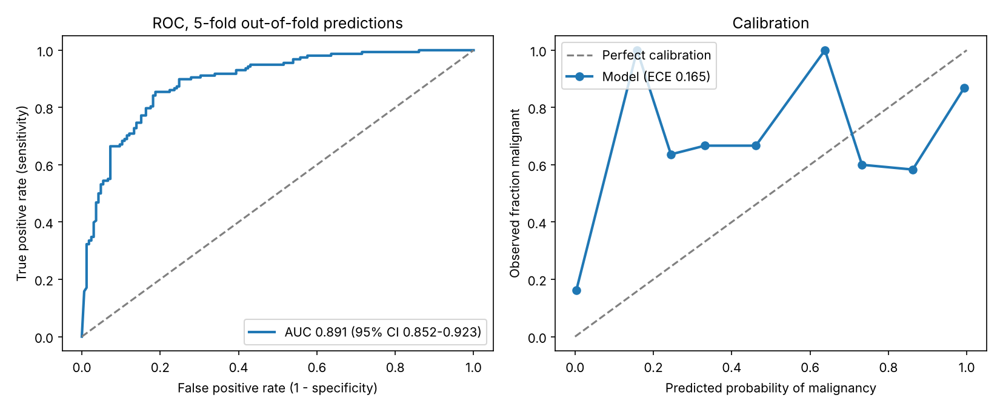
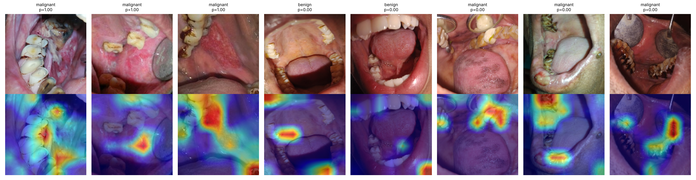

# Oral lesion classifier: Mendeley baseline (Dinesh Raj P)

A separate experiment by **Dinesh Raj P**, under the guidance of Dr. Kiruthika M (CINTEL, SRMIST).
It is **not** the model MedVision ships. The app's triage model, trained on SMART-OM, lives in [`ml/`](../../ml) and was built by Trefan Kagoo.

**Question:** how well does MobileNetV3-Small, small enough to run on a phone, separate benign from malignant oral lesions in smartphone and intraoral photos, and can its confidence be trusted?

## Data
[Oral Images Dataset](https://doi.org/10.17632/mhjyrn35p4.2), Mendeley Data v2 (CC BY 4.0): 165 benign and 158 malignant photos. Only `original_data` is used; the augmented copies are excluded so that flipped or rotated duplicates of one photo cannot sit in both training and test folds. Near-duplicate photos are grouped by image hash (none were found).

## Method
- MobileNetV3-Small (timm `mobilenetv3_small_100`, ImageNet-pretrained), 224 px, 25 epochs, AdamW, class-weighted loss
- Stratified, group-aware 5-fold cross-validation; best epoch and Youden threshold chosen on a validation slice of each training fold
- Metrics on all 323 out-of-fold predictions: AUC with a 1,000-sample bootstrap 95% CI, sensitivity, specificity, ECE (10 bins), Grad-CAM

## Results

| Metric | Value |
|---|---|
| AUC | **0.891** (95% CI 0.852–0.923) |
| Sensitivity | 81.0% (128 / 158) |
| Specificity | 81.2% (134 / 165) |
| AUC by fold | 0.939, 0.936, 0.913, 0.848, 0.817 (mean 0.891 ± 0.055) |
| ECE | 0.165 |

## What the results say
- **Overconfident:** 84% of predictions are above 0.95 or below 0.05, so the scores cannot yet be used to decide referrals. Calibration (temperature scaling) is the next step.
- **Possible shortcut:** Grad-CAM shows some predictions attending to teeth and dental instruments rather than the lesion. Cropping to the lesion should test this.
- **Limits:** 323 images from one region, no patient IDs, image-level labels with no stated confirmation method, single-visit only. Nothing has been tested with patients.

## Files
- `oral_lesion_mobilenetv3.ipynb`: the full pipeline (runs in Google Colab on a T4 GPU in about 15 minutes)
- `results/`: summary, per-fold metrics, out-of-fold predictions, figures
